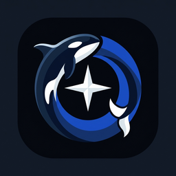

<div align="center">
  
  <h1>Starbish Browser</h1>
  <p><strong>El navegador de privacidad que combina el alma de Mullvad, la velocidad de Brave y búsquedas inteligentes con Bing.</strong></p>
</div>

---

## 🌊 ¿Qué es Starbish Browser?

**Starbish Browser** es un navegador web moderno, minimalista y centrado en la privacidad radical. Diseñado con una identidad visual inspirada en la nobleza y fluidez de la orca marina, Starbish elimina el rastreo invasivo de la web actual manteniendo la velocidad y compatibilidad de Chromium.

### 🛡️ Los 3 Pilares de Starbish

1. **La Privacidad de Mullvad:**
   - **Modo Amnésico (Zero-Trace):** Destrucción automática de cookies, almacenamiento local y caché al salir de la sesión.
   - **Botón de Nueva Identidad:** Reinicia tu navegación limpia y anónima con un solo clic.
   - **Cero Telemetría:** Sin recolección de estadísticas ni conexiones silenciosas a servidores externos.
   - **DNS Seguro Cifrado (DoH):** Consultas DNS encriptadas con bloqueo de publicidad a nivel de red (Mullvad DoH & Quad9).
   - **Protección contra fugas de WebRTC:** Blindaje contra la exposición de tu dirección IP pública/local real.
   - **Cabeceras de Privacidad Nativas:** Inyección automática de `DNT: 1` (*Do Not Track*) y `Sec-GPC: 1` (*Global Privacy Control*).

2. **El Escudo y Rendimiento de Brave:**
   - **Escudo Starbish Integrado:** Motor de bloqueo a nivel de red basado en listas de EasyList y uBlock Origin.
   - **Bloqueo de Anuncios:** Filtra anuncios en vídeo de YouTube, banners publicitarios invasivos y pop-ups.
   - **Contador en Tiempo Real:** Visualiza exactamente cuántos rastreadores y anuncios ha bloqueado tu escudo en la sesión activa.
   - **Interfaz Oscura Moderna:** Pestañas fluidas en azul navy y negro obsidiana, con atajos de teclado intuitivos (`Ctrl+T`, `Ctrl+W`, `Ctrl+L`).

3. **Búsqueda por Defecto en Bing:**
   - Búsquedas directas desde la barra de direcciones (*Omnibox*) utilizando **Microsoft Bing** como motor predeterminado inamovible, sin intermediarios ni rastreo de historial.

---

## 🚀 Inicio Rápido

### Requisitos
* Node.js (v18+)
* npm

### Instalación y Ejecución

```bash
# Clonar el repositorio
git clone https://github.com/drylexx3/starbish-browser.git
cd starbish-browser

# Instalar dependencias
npm install

# Iniciar Starbish Browser
npm start
```

### Empaquetado para Linux (.deb y .AppImage)

```bash
# Generar paquetes instalables
npm run dist
```
Los archivos `.deb` y `.AppImage` se generarán dentro de la carpeta `dist/`.

---

## ⌨️ Atajos de Teclado

| Atajo | Acción |
| :--- | :--- |
| `Ctrl + T` | Abrir nueva pestaña |
| `Ctrl + W` | Cerrar pestaña activa |
| `Ctrl + L` | Enfocar la barra de direcciones / búsqueda |

---

## 📄 Licencia

Este proyecto está bajo la licencia **GPL-3.0**. Libre, privado y transparente.
